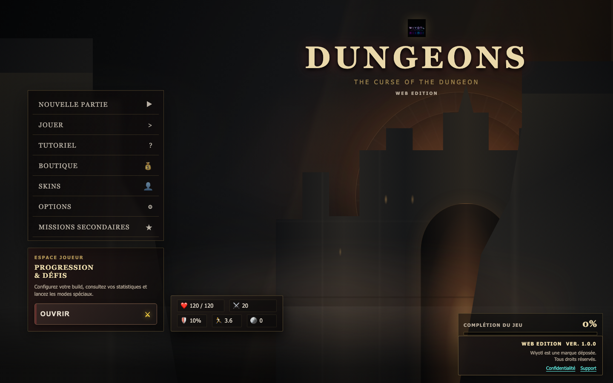
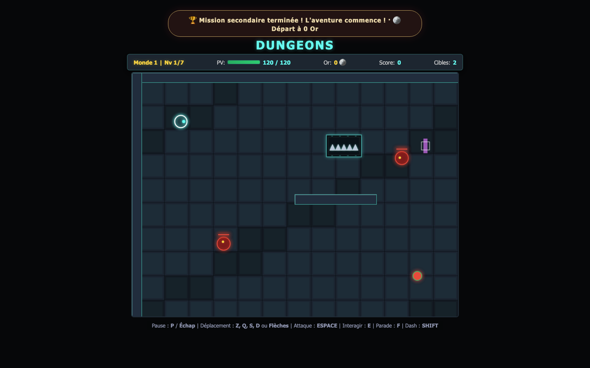
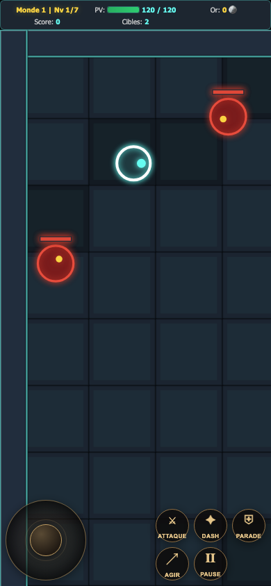

# Dungeons: The Curse of the Dungeon <sup>WEB Edition</sup>

**Français** · [English](README_en.md) · **Version 1.0.0**

> **Entrez dans le donjon. Brisez la malédiction.**<br>
> Un jeu d’action fantastique jouable dans votre navigateur, sur ordinateur comme sur mobile.

<p align="center">
  <a href="https://wiyotl.github.io/dungeons-the-curse-of-the-dungeon/"><strong>JOUER MAINTENANT</strong></a>
  &nbsp;·&nbsp;
  <a href="privacy.html">Confidentialité</a>
  &nbsp;·&nbsp;
  <a href="mailto:contact.wiyotl@gmail.com">Support</a>
</p>

## Captures d’écran

<p align="center">
  
  
</p>
<p align="center"><em>Écran titre · Campagne sur ordinateur</em></p>

<p align="center">
  
</p>
<p align="center"><em>Interface mobile en mode portrait</em></p>

## L’aventure

Explorez **3 mondes et 21 niveaux**, affrontez leurs gardiens et cherchez les **7 salles secrètes**. Chaque partie vous invite à maîtriser le combat, choisir votre approche et améliorer votre héros avant d’aller plus loin.

### Ce qui vous attend

- **Une campagne complète** avec niveaux, ennemis, boss et progression sauvegardée.
- **Un combat d’action** : attaques, esquives rapides, parades et interactions.
- **Trois archétypes** — Vanguard, Duelist et Ranger — pour varier votre façon de jouer.
- **Des améliorations et une boutique** pour faire évoluer votre progression.
- **Des défis quotidiens à seed partageable** : invitez vos amis à tenter la même configuration.
- **Le mode sans fin et ses objectifs de maîtrise**, puis **New Game+** après la campagne.
- **Tutoriel interactif** et options d’accessibilité : contraste renforcé, texte agrandi et animations réduites.
- **Suivi de complétion** pour vous aider à poursuivre le 100 % : campagne, secrets, missions et bestiaire.

## Jouer sur mobile

Le jeu adapte son terrain à l’écran et propose un **joystick tactile**, ainsi que des boutons dédiés à l’attaque, au dash, à la parade, à l’interaction et à la pause. Le format portrait ou paysage est pris en charge.

Sur iPhone ou iPad :

1. Ouvrez le [jeu en HTTPS](https://wiyotl.github.io/dungeons-the-curse-of-the-dungeon/) dans Safari.
2. Touchez **Partager**, puis **Sur l’écran d’accueil** pour l’installer comme une application web.
3. Lancez le jeu une première fois avec une connexion Internet afin de charger et mettre en cache ses fichiers.

La version PWA peut conserver le shell du jeu hors ligne après ce premier chargement. Les fonctions qui nécessitent Internet, notamment les éventuelles fonctions cloud, ne sont pas disponibles hors connexion.

## Commandes

| Action | Clavier |
| --- | --- |
| Déplacement | ZQSD, WASD ou flèches directionnelles |
| Attaque | Espace |
| Interagir | E |
| Parade | F |
| Dash | Maj |
| Pause | P ou Échap |

Sur téléphone, utilisez le joystick et les boutons affichés à l’écran.

## Jouer en local

Le jeu est une application web statique : aucun backend n’est requis pour lancer une partie. Installez Python 3, puis démarrez un serveur local à la racine du projet :

```sh
python3 -m http.server 8000
```

Ouvrez <http://localhost:8000/> dans votre navigateur. Pour tester sur un téléphone connecté au même Wi-Fi, démarrez le serveur ainsi :

```sh
python3 -m http.server 8000 --bind 0.0.0.0
```

Puis ouvrez `http://<adresse-IP-de-l-ordinateur>:8000/` sur le téléphone. Pour ce test local, l’ordinateur et le serveur doivent rester allumés. La version GitHub Pages, elle, est accessible sans votre ordinateur.

## Progression et confidentialité

La progression est stockée localement dans le navigateur utilisé pour jouer. Elle ne se synchronise donc pas automatiquement entre appareils. La sauvegarde cloud Supabase est facultative et **désactivée par défaut** : elle nécessite une configuration dédiée.

Consultez la [politique de confidentialité](privacy.html) pour les informations sur les données et le support. Les fonctions cloud requièrent une connexion Internet.

## Développement

Prérequis : Node.js et npm.

```sh
npm ci
npx playwright install chromium
npm test
npm run build
```

- `npm test` exécute les tests unitaires et les parcours navigateur Playwright.
- `npm run build` vérifie les scripts, le manifeste PWA et les fichiers requis.
- Le workflow [GitHub Actions](.github/workflows/pages.yml) lance les vérifications avant de publier le site.

### Structure du projet

| Chemin | Rôle |
| --- | --- |
| `index.html` | Jeu, interface et styles |
| `js/` | Moteur, progression, sauvegardes et fonctions de jeu |
| `icons/` | Icônes de l’application |
| `screenshots/` | Captures d’écran présentées dans ce README |
| `e2e/`, `test/` | Tests navigateur et unitaires |
| `privacy.html` | Politique de confidentialité et support |
| `service-worker.js`, `manifest.webmanifest` | Fonctions PWA |

Pour les détails de publication ou de configuration Supabase, voir le [guide de déploiement](DEPLOYMENT.md).
