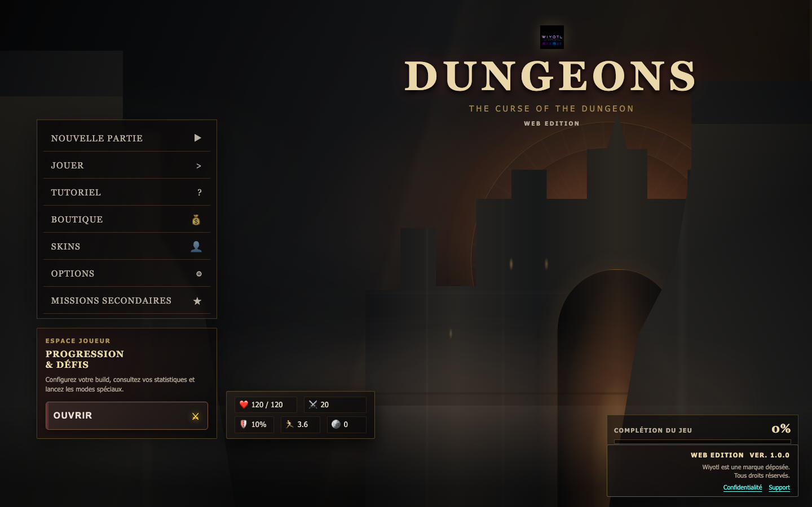
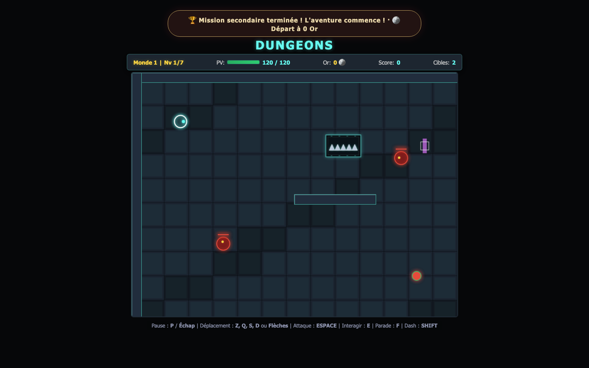
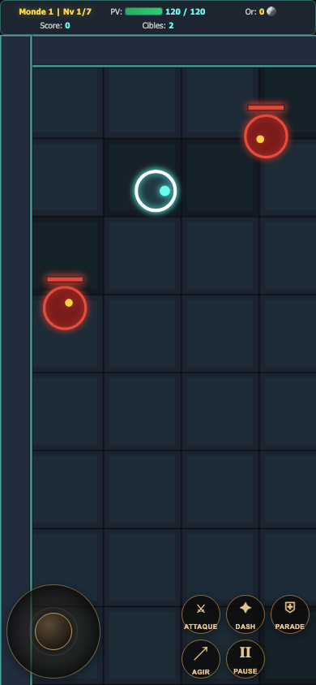

# Dungeons: The Curse of the Dungeon <sup>WEB Edition</sup>

**Français** · [English](README_en.md) · **V1.1.2**

> **Entrez dans le donjon. Brisez la malédiction.**<br>
> Un jeu d’action fantastique jouable dans votre navigateur, sur ordinateur comme sur mobile.

<p align="center">
  <a href="https://wiyotl.github.io/dungeons-the-curse-of-the-dungeon/"><strong>JOUER MAINTENANT</strong></a>
  &nbsp;·&nbsp;
  <a href="privacy.html">Confidentialité</a>
  &nbsp;·&nbsp;
  <a href="mailto:contact.wiyotl@gmail.com">Support</a>
</p>

## Captures d’écran

<p align="center">
  
  
</p>
<p align="center"><em>Écran titre · Campagne sur ordinateur</em></p>

<p align="center">
  
</p>
<p align="center"><em>Interface mobile en mode portrait</em></p>

## L’aventure

Explorez **3 mondes et 21 niveaux**, affrontez leurs gardiens et cherchez les **7 salles secrètes**. Chaque partie vous invite à maîtriser le combat, choisir votre approche et améliorer votre héros avant d’aller plus loin.

### Ce qui vous attend

- **Une campagne complète** avec niveaux, ennemis, boss et progression sauvegardée.
- **Un combat d’action** : attaques, esquives rapides, parades et interactions.
- **Une interface en français et en anglais**, sélectionnée selon la langue du navigateur et modifiable à tout moment.
- **Quatre archétypes** — Vanguard, Duelist, Ranger et Paladin — pour varier votre façon de jouer.
- **Des améliorations et une boutique** pour faire évoluer votre progression.
- **Des défis quotidiens à seed partageable** : invitez vos amis à tenter la même configuration.
- **Le mode sans fin et ses objectifs de maîtrise**, puis **New Game+** après la campagne.
- **Tutoriel interactif** et options d’accessibilité : contraste renforcé, texte agrandi et animations réduites.
- **Suivi de complétion** pour vous aider à poursuivre le 100 % : campagne, missions, salles secrètes, bestiaire, défis spéciaux, builds, difficultés et leviers.

## Jouer sur mobile

Le jeu adapte son terrain à l’écran et propose un **joystick tactile**, ainsi que des boutons dédiés à l’attaque, au dash, à la parade, à l’interaction et à la pause. Le format portrait ou paysage est pris en charge. Le zoom accidentel de la page pendant la partie (double-tap ou pincement sur les contrôles) est désactivé en pleine partie ; les menus restent zoomables.

Sur iPhone ou iPad :

1. Ouvrez le [jeu en HTTPS](https://wiyotl.github.io/dungeons-the-curse-of-the-dungeon/) dans Safari.
2. Touchez **Partager**, puis **Sur l’écran d’accueil** pour l’installer comme une application web.
3. Lancez le jeu une première fois avec une connexion Internet afin de charger et mettre en cache ses fichiers.

La version PWA peut conserver le shell du jeu hors ligne après ce premier chargement. Les fonctions qui nécessitent Internet, notamment les éventuelles fonctions cloud, ne sont pas disponibles hors connexion.

## Commandes

| Action | Clavier |
| --- | --- |
| Déplacement | ZQSD, WASD ou flèches directionnelles |
| Attaque | Espace |
| Interagir | E |
| Parade | F |
| Dash | Maj |
| Pause | P ou Échap |

Sur téléphone, utilisez le joystick et les boutons affichés à l’écran.

## Jouer en local

Le jeu est une application web statique : aucun backend n’est requis pour lancer une partie. Installez Python 3, puis démarrez un serveur local à la racine du projet :

```sh
python3 -m http.server 8000
```

Ouvrez <http://localhost:8000/> dans votre navigateur. Pour tester sur un téléphone connecté au même Wi-Fi, démarrez le serveur ainsi :

```sh
python3 -m http.server 8000 --bind 0.0.0.0
```

Puis ouvrez `http://<adresse-IP-de-l-ordinateur>:8000/` sur le téléphone. Pour ce test local, l’ordinateur et le serveur doivent rester allumés. La version GitHub Pages, elle, est accessible sans votre ordinateur.

## Progression et confidentialité

La progression est stockée localement dans le navigateur utilisé pour jouer. Elle ne se synchronise donc pas automatiquement entre appareils. La sauvegarde cloud Supabase est facultative et **désactivée par défaut** : elle nécessite une configuration dédiée.

Consultez la [politique de confidentialité](privacy.html) pour les informations sur les données et le support. Les fonctions cloud requièrent une connexion Internet.

## Développement

Prérequis : Node.js et npm.

```sh
npm ci
npx playwright install chromium
npm test
npm run build
```

- `npm test` exécute les tests unitaires et les parcours navigateur Playwright.
- `npm run build` vérifie les scripts, le manifeste PWA et les fichiers requis.
- Le workflow [GitHub Actions](.github/workflows/pages.yml) lance les vérifications avant de publier le site.

### Structure du projet

| Chemin | Rôle |
| --- | --- |
| `index.html` | Jeu, interface et styles |
| `js/` | Moteur, progression, sauvegardes et fonctions de jeu |
| `icons/` | Icônes de l’application |
| `screenshots/` | Captures d’écran présentées dans ce README |
| `e2e/`, `test/` | Tests navigateur et unitaires |
| `privacy.html` | Politique de confidentialité et support |
| `service-worker.js`, `manifest.webmanifest` | Fonctions PWA |

Pour les détails de publication ou de configuration Supabase, voir le [guide de déploiement](DEPLOYMENT.md).

## Mises à jour

### V1.1.2 (25 novembre 2026)

- Écran noir corrigé (iPhone, macOS, Windows) : balise `</div>` manquante dans `#victory-screen` — l'interface et le canvas étaient imbriqués dans un écran masqué
- Libellé « · MAX » des PV réservé au plafond de 300 PV (menu et HUD), aligné sur les autres statistiques
- Compteur de leviers « Leviers X / 10 » ajouté au panneau Progression & Défis (stat en tête du panneau + ligne dans les statistiques avancées)
- Zoom tactile accidentel corrigé en pleine partie (viewport durci, touch-action, gestes iOS bloqués, sélection de texte désactivée) ; les menus restent zoomables
- Cache du service worker passé à v5 : les mises à jour sont désormais bien servies sur iPhone/Android (ancien cache purgé)
- Serveur de test local avec cache désactivé (`Serveur-Test-Iphone.command`) : Safari recharge toujours la dernière version
- Le 100 % de complétion vérifié atteignable : poids exacts, 10 leviers générés, mission récursive « Fini les missions secondaires ! » fonctionnelle
- Timer Speed-run basé sur `performance.now()`, CSP stricte, fuseau local du défi quotidien
- Test e2e de la parade stabilisé (fenêtre de vérification élargie)

### V1.1.1 (21 novembre 2026)

- Paladin "Bouclier absorbant" implémenté : 25% chance de bloquer un coup entrant
- AudioContext resume corrigé (playUiTone, startAmbientMusic, playCue async avec await)
- validateImportedSave assoupli pour vieilles sauvegardes (buildModifiers, shopUpgrades optionnels)
- Séparation vector optimisé : spatial hash grid (80px cells) O(n²) → O(n)
- runtimeError remis à null sur loadLevel() succès
- Typos FR : "déjà", "Récupère", "Obtient", "Subit" (harmonisation 3e personne)
- HTML : suppression div orphelin, wrapper cloud-save-section, verbes boutique harmonisés

### V1.1.0 (20 novembre 2026)

- PV de départ fixés à 120 (base)
- Défense de départ fixée à 10 % pour tous les builds
- Plafond de vitesse ajouté (8 max)
- Nouveau build : Paladin (bouclier absorbant, soin par parade réussie)
- Nouvel artefact boutique : Vampirisme (soins sur coup critique)
- Badge « Collectionneur complet » quand les 19 produits de la boutique sont achetés
- Bouton « ACQUIS » corrigé pour les artefacts permanents de la boutique
- Section « Complétion du jeu » rendue visible dans le menu titre
- Passage de la version 1.0.0 à 1.1.1

### V1.0.0 (11 novembre 2026)

- Version initiale
- Campagne : 3 mondes, 21 niveaux, 3 boss
- 7 salles secrètes
- 3 builds : Vanguard, Duelist, Ranger
- 30 missions secondaires avec récompenses
- Modes : New Game+, Mode Sans Fin, Boss-Rush, Défi Quotidien seedé
- Boutique : skins, améliorations de caractéristiques, artefacts permanents
- Sauvegarde locale + cloud Supabase optionnel (désactivé par défaut)
- PWA, contrôles tactiles, accessibilité
- Interface FR/EN

## Communauté et licence

- [Contribuer au projet](CONTRIBUTING.md)
- [Code de conduite](CODE_OF_CONDUCT.md)
- [Politique de sécurité](SECURITY.md)
- [Licence Apache-2.0](LICENSE)
- [Signaler un bug ou proposer une amélioration](https://github.com/WIYOTL/dungeons-the-curse-of-the-dungeon/issues)

Le contenu de ce dépôt est distribué sous licence Apache-2.0, à l’exception de la marque, du nom et des logos Wiyotl, qui ne sont pas concédés par cette licence.

---

**Wiyotl est une marque déposée. Tous droits réservés.**
