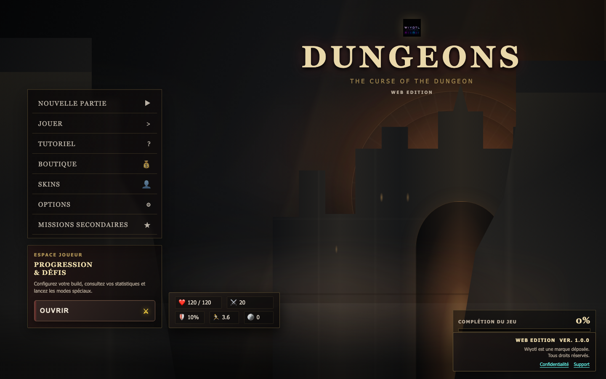
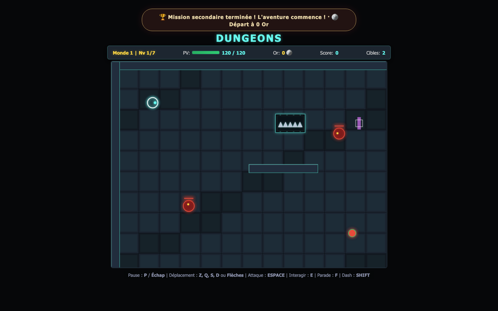
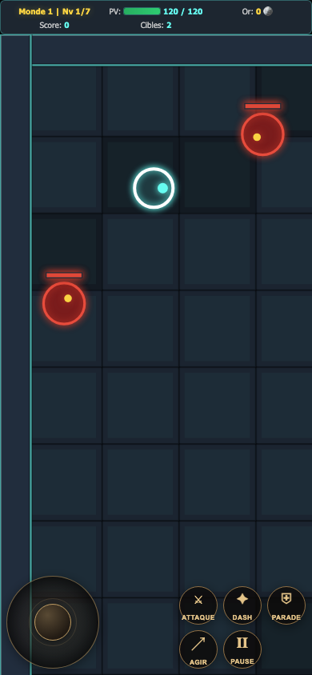

# Dungeons: The Curse of the Dungeon <sup>WEB Edition</sup>

[Français](README.md) · **English** · **Version 1.0.0**

> **Enter the dungeon. Break the curse.**<br>
> A fantasy action game you can play in your browser on desktop or mobile.

<p align="center">
  <a href="https://wiyotl.github.io/dungeons-the-curse-of-the-dungeon/"><strong>PLAY NOW</strong></a>
  &nbsp;·&nbsp;
  <a href="privacy.html">Privacy</a>
  &nbsp;·&nbsp;
  <a href="mailto:contact.wiyotl@gmail.com">Support</a>
</p>

## Screenshots

<p align="center">
  
  
</p>
<p align="center"><em>Title screen · Desktop campaign</em></p>

<p align="center">
  
</p>
<p align="center"><em>Portrait mobile gameplay</em></p>

## The adventure

Explore **3 worlds and 21 levels**, face their guardians, and uncover **7 secret rooms**. Master the combat, choose your approach, and improve your hero as you push deeper into the dungeon.

### What awaits

- **A full campaign** with levels, enemies, bosses, and persistent progression.
- **Action combat** with attacks, quick dashes, parries, and interactions.
- **Three hero archetypes** — Vanguard, Duelist, and Ranger — for different play styles.
- **Upgrades and a shop** to shape your progression.
- **Shareable seeded daily challenges**: invite friends to tackle the same setup.
- **Endless mode and mastery goals**, followed by **New Game+** after the campaign.
- An **interactive tutorial** and accessibility options: high contrast, larger text, and reduced motion.
- **Completion tracking** to guide your 100% run across the campaign, secrets, missions, and bestiary.

## Play on mobile

The playfield adapts to your screen and includes an **on-screen joystick** plus dedicated buttons for attack, dash, parry, interaction, and pause. Both portrait and landscape layouts are supported.

On iPhone or iPad:

1. Open the [HTTPS game site](https://wiyotl.github.io/dungeons-the-curse-of-the-dungeon/) in Safari.
2. Tap **Share**, then **Add to Home Screen** to install it as a web app.
3. Launch the game once while online so its files can load and be cached.

After the first load, the PWA can keep the game shell available offline. Features that require an internet connection, including any cloud functionality, remain unavailable offline.

## Controls

| Action | Keyboard |
| --- | --- |
| Move | ZQSD, WASD, or arrow keys |
| Attack | Space |
| Interact | E |
| Parry | F |
| Dash | Shift |
| Pause | P or Esc |

On phones and tablets, use the on-screen joystick and action buttons.

## Run locally

This is a static web app; no backend is required to play. Install Python 3 and start a local server from the project root:

```sh
python3 -m http.server 8000
```

Open <http://localhost:8000/> in your browser. To test on a phone connected to the same Wi-Fi, start the server with:

```sh
python3 -m http.server 8000 --bind 0.0.0.0
```

Then open `http://<your-computer-IP>:8000/` on the phone. For local testing, keep the computer and server running. The GitHub Pages version is available without your computer.

## Progress and privacy

Progress is stored locally in the browser you play with, so it does not automatically sync between devices. Optional Supabase cloud saves are **disabled by default** and require separate configuration.

Read the [privacy policy](privacy.html) for information about data and support. Cloud features require an internet connection.

## Development

Requirements: Node.js and npm.

```sh
npm ci
npx playwright install chromium
npm test
npm run build
```

- `npm test` runs unit tests and Playwright browser journeys.
- `npm run build` verifies scripts, the PWA manifest, and required files.
- The [GitHub Actions workflow](.github/workflows/pages.yml) runs checks before publishing the site.

### Project structure

| Path | Purpose |
| --- | --- |
| `index.html` | Game, interface, and styles |
| `js/` | Game engine, progression, saves, and gameplay systems |
| `icons/` | App icons |
| `screenshots/` | Screenshots featured in this README |
| `e2e/`, `test/` | Browser and unit tests |
| `privacy.html` | Privacy policy and support |
| `service-worker.js`, `manifest.webmanifest` | PWA support |

For publishing or Supabase setup, see the [deployment guide](DEPLOYMENT.md).

## Community and license

- [Contributing guide](CONTRIBUTING.md)
- [Code of Conduct](CODE_OF_CONDUCT.md)
- [Security policy](SECURITY.md)
- [Apache-2.0 license](LICENSE)
- [Report a bug or suggest a feature](https://github.com/WIYOTL/dungeons-the-curse-of-the-dungeon/issues)

The contents of this repository are distributed under the Apache-2.0 license, except for the Wiyotl name, trademarks, and logos, which are not licensed by it.

---

**Wiyotl est une marque déposée. Tous droits réservés.**
